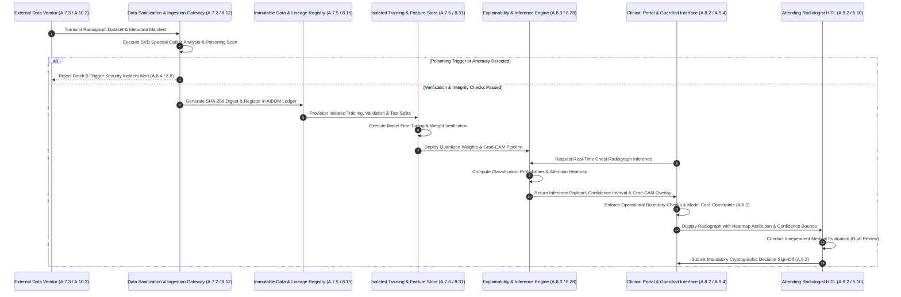

# Chapter 04: Annex A.7 Data Governance, A.8 Transparency, A.9 Use of AI Systems & A.10 Third-Party Relationships

## 1. Statutory Baseline & Technical Control Matrix

### 1.1 Architectural Foundations of Data Governance, Transparency, Responsible Use, and Supply Chain Accountability
Under traditional cybersecurity management systems governed by ISO/IEC 27002:2022, data controls prioritize the confidentiality, integrity, and availability (CIA) of deterministic information assets. Key controls such as 8.12 (Data leakage prevention), 8.10 (Information deletion), 8.24 (Use of cryptography), and 5.10 (Acceptable use of information and other assets) secure static records at rest, in transit, and during access authorization.

Under ISO/IEC 42001:2023, data within Artificial Intelligence Management Systems (AIMS) serves as the primary determinant of model behavior. Data directly programs mathematical weights, probabilistic inferences, and automated outputs. Corrupted training data, sampling bias, data drift, or adversarial poisoning directly induce algorithmic discrimination, hallucinations, systemic backdoors, or physical failures.

To address AI risks, ISO/IEC 42001 establishes four interdependent control domains:
1. **Annex A.7 (Data for AI Systems)**: Establishes lifecycle controls spanning acquisition licensing, provenance tracking, statistical data quality assessment (e.g., Population Stability Index, missingness, covariance shifts), and feature isolation to prevent target leakage and training-serving skew.
2. **Annex A.8 (Information for Interested Parties)**: Enforces end-to-end transparency, mandatory explainability (feature attribution via SHAP, Integrated Gradients, or Grad-CAM), standardized model documentation (Model Cards, Data Cards), and statutory notification channels for algorithmic incidents.
3. **Annex A.9 (Use of AI Systems)**: Defines operational boundaries for intended use, dual-custody human oversight mechanisms (Human-in-the-Loop, Human-on-the-Loop), automated guardrails against prompt injection and jailbreaks, and policies preventing automation bias.
4. **Annex A.10 (Third-Party Relationships)**: Establishes a shared responsibility framework across AI supply chains, clearly partitioning liabilities among foundation model providers (Model-as-a-Service), fine-tuning developers, platform hosts, and end deployers.

---

### 1.2 Statutory Crosswalk & Technical Control Matrix (Annex A.7 - A.10 vs. ISO/IEC 27002:2022)

| ISO 42001 Control | Official Control Title | ISO 27002:2022 Mapping | Integration Type | Technical Control Implementation & Telemetry Metrics (KPI / KRI / KCI) |
| :--- | :--- | :--- | :--- | :--- |
| **A.7.1** *(Obj)* | Data for AI systems | **8.12** Data leakage prevention | **Governance Baseline** | Mandate end-to-end governance policies for all datasets applied across training, fine-tuning, validation, and testing pipelines. **KCI**: 100% of production datasets covered by formal governance policies. |
| **A.7.2** | Data for development and enhancement of AI systems | **8.28** Secure coding **8.12** Data leakage prevention | **AI-Specific Deepening** | Implement automated data preprocessing, synthetic data generation, pseudonymization, and differential privacy ($\epsilon, \delta$ budgets) to protect training corpuses. **KPI**: 100% preprocessing pipeline execution logged with immutable cryptographic digests. |
| **A.7.3** | Acquisition of data | **5.20** Addressing information security within supplier agreements **5.36** Compliance with policies | **Existing Extension** | Enforce copyright, intellectual property, and licensing validation for web-scraped and commercial datasets; audit consent and regulatory authorizations prior to ingestion. **KPI**: 100% external acquisition compliance and IP clearance verification rate. |
| **A.7.4** | Data quality for AI systems | **8.16** Monitoring activities **8.8** Management of technical vulnerabilities | **AI-Specific Deepening** | Continuous telemetry tracking statistical completeness, representativeness, label noise, and covariate shift; automated alerts for Population Stability Index (PSI). **KRI**: Training-to-validation Population Stability Index (PSI) maintained < 0.10. |
| **A.7.5** | Provenance of data | **8.15** Logging **8.24** Use of cryptography | **AI-Specific Deepening** | Deploy Data Version Control (DVC) and AI Software Bill of Materials (AIBOM); bind every dataset commit to immutable SHA-256 cryptographic hashes and lineage graphs. **KPI**: 100% data provenance and lineage traceability across all deployed model iterations. |
| **A.7.6** | Data preparation | **8.31** Separation of environments **8.28** Secure coding | **AI-Specific Deepening** | Secure access to centralized Feature Stores; strictly isolate training, validation, and test splits; execute automated tests to detect target leakage and temporal leakage. **KCI**: Zero detected occurrences of data leakage across dataset partitions. |
| **A.8.1** *(Obj)* | Information for interested parties | **5.37** Documented operating procedures | **Governance Baseline** | Establish organizational protocols to communicate system capabilities, operational constraints, residual risks, and intended use to all internal and external stakeholders. **KPI**: 100% stakeholder disclosure protocols validated by legal and compliance functions. |
| **A.8.2** | System documentation and specifications | **5.37** Documented operating procedures **8.25** Secure development life cycle | **ISO 42001 Exclusive** | Publish standardized, version-controlled Model Cards and Data Cards detailing model architecture, performance baselines, known limitations, and bias evaluation benchmarks. **KPI**: 100% of production models accompanied by approved, version-locked Model Cards. |
| **A.8.3** | Understandability of information | **5.37** Documented operating procedures | **ISO 42001 Exclusive** | Embed user-facing Explainable AI (XAI) outputs (e.g., local feature attribution, SHAP values, counterfactual explanations); deploy unambiguous synthetic media / AI disclosure badges. **KCI**: 100% of automated customer-facing decision interfaces display AI disclosure notices. |
| **A.8.4** | External reporting | **6.8** Information security event reporting **5.36** Compliance with policies | **Existing Extension** | Implement automated escalation runbooks to notify statutory authorities and affected subjects of critical algorithmic failures, privacy breaches, or systemic bias within 72 hours. **KPI**: 100% regulatory notification compliance rate within statutory reporting windows. |
| **A.8.5** | Communication of incidents | **6.8** Information security event reporting **8.15** Logging | **Existing Extension** | Deploy public status portals and user notifications communicating real-time model degradation, anomalous inference spikes, maintenance windows, and mitigation advisories. **MTTD/MTTR**: Public incident notification issued in < 60 minutes from severity-1 confirmation. |
| **A.9.1** *(Obj)* | Use of AI systems | **5.10** Acceptable use of information and other assets | **Governance Baseline** | Guarantee that deployed AI systems operate strictly within validated operational boundaries and risk thresholds, mitigating misuse and downstream harms. **KPI**: 100% operational AI applications mapped to authorized operational boundaries. |
| **A.9.2** | Processes for responsible use of AI systems | **5.36** Compliance with policies **6.3** Information security awareness | **Existing Extension** | Implement role-based access control, dual-custody verification, and mandatory Human-in-the-Loop (HITL) review protocols for all high-impact automated inferences. **KPI**: 100% compliance rate for required human sign-offs on high-impact algorithmic decisions. |
| **A.9.3** | Objectives for responsible use of AI systems | **5.1** Policies for information security | **Existing Extension** | Establish balanced scorecard metrics aligning corporate algorithmic revenue targets with safety constraints, fairness thresholds, and error tolerances. **KCI**: 100% alignment between operational AI Key Performance Indicators and risk policies. |
| **A.9.4** | Intended use of AI systems | **8.1** User endpoint devices **8.27** Secure architecture principles | **Existing Extension** | Enforce multi-tier input/output guardrails, semantic classifiers, and prompt-filtering middleware to block prompt injection, jailbreaks, and out-of-scope system interactions. **KRI**: Zero unauthorized bypasses of operational scope; > 99.8% prompt injection interception. |
| **A.10.1** *(Obj)* | Third-party relationships | **5.19** Information security in supplier relationships | **Governance Baseline** | Define, enforce, and govern organizational and legal responsibilities across all external AI suppliers, foundational model providers, data vendors, and consumers. **KCI**: 100% of third-party AI partnerships governed by enforceable accountability frameworks. |
| **A.10.2** | Allocation of responsibilities | **5.2** Division of responsibilities **5.20** Supplier agreements | **Existing Extension** | Formalize shared responsibility matrices across contracts, identifying legal liabilities for Foundation Model Providers, Model Fine-Tuners, and System Deployers. **KPI**: 100% of external AI contracts incorporate explicit AI RACI and liability matrices. |
| **A.10.3** | Suppliers | **5.21** Managing ICT supply chain **5.22** Monitoring cloud services | **AI-Specific Deepening** | Conduct AI-specific supplier assessments auditing training data provenance, vulnerability management, API SLAs, data retention, and fine-tuning privacy assurances. **KRI**: Zero high-risk unpatched vulnerabilities or undocumented training corpuses in supplier stacks. |
| **A.10.4** | Customers | **5.20** Supplier agreements **5.37** Documented procedures | **Existing Extension** | Supply client onboarding documentation, API security guardrails, acceptable use policies, and integration manuals specifying the boundaries of safe operational use. **KPI**: 100% of enterprise customers provided with complete integration and security manuals. |

---

## 2. Production Incident & Remediation Architecture

### 2.1 Incident Context: Medical Diagnostic Computer Vision Poisoning & Black-Box Failure
A regional healthcare network deployed an automated deep convolutional neural network (CNN) in emergency departments to perform real-time triage on chest radiographs, classifying acute pulmonary pathologies such as tension pneumothorax and severe bacterial pneumonia. To augment training performance, the internal machine learning engineering team ingested an open-source clinical research dataset containing 500,000 annotated radiographs provided by an external academic consortium.

Three months post-deployment, attending emergency radiologists reported an alarming anomaly: the model exhibited a sudden 41.5% false-negative rate on critical pneumonia cases originating from an affiliated rural triage clinic. Critically, the system provided binary classification outputs with zero explainability visualizations or feature attribution, preventing clinicians from inspecting the root causes of divergent inferences.

A digital forensics and AI security investigation revealed that the external research dataset had been subjected to an adversarial data poisoning attack. Malicious actors had injected high-frequency spatial watermarks (a subtle pixel perturbation pattern in the lower-right margin) into a subset of pneumonia-positive radiographs, re-labeling them as "Normal." During training, the CNN converged on this shortcut feature rather than actual lung consolidations. Furthermore, emergency room operational leadership, seeking to clear patient backlogs, had disabled the mandatory Human-in-the-Loop (HITL) dual-signature workflow during night shifts, directly converting algorithmic blind spots into severe patient misdiagnoses.

### 2.2 Root Cause Analysis (RCA)
1. **Absence of Data Acquisition Validation & Cryptographic Provenance (A.7.3, A.7.5, ISO 27002 5.20, 8.12)**: The external dataset was ingested via unauthenticated public mirrors without verifying digital signatures, publisher identities, or cryptographic checksums. No AI Software Bill of Materials (AIBOM) or Data Version Control (DVC) tracking was established, allowing poisoned samples to enter the centralized feature repository unchecked.
2. **Deficiency in Data Quality Audits & Spectral Poisoning Detection (A.7.4, A.7.6, ISO 27002 8.16, 8.8)**: Preprocessing pipelines lacked automated anomaly detection, frequency-domain filtering, or Singular Value Decomposition (SVD) outlier analysis. Consequently, the high-frequency pixel perturbations remained undetected during ETL processing.
3. **Total Omission of Explainability Telemetry & System Constraints (A.8.2, A.8.3, ISO 27002 5.37, 8.15)**: The inference service failed to implement feature attribution engines (e.g., Grad-CAM heatmaps or Integrated Gradients). Clinicians were not provided with Model Cards detailing hardware input resolution limits or sensitivity to low-contrast radiograph artifacts.
4. **Intended Use Boundary Breakdown & Human Oversight Bypass (A.9.2, A.9.4, ISO 27002 5.10, 5.36)**: Clinical administration unilaterally revoked the system's operational constraints (intended solely as a diagnostic decision-support assistant), overriding the secondary radiologist sign-off requirement during off-peak hours and inducing severe automation bias.
5. **Third-Party Supply Chain Governance Failure (A.10.2, A.10.3, ISO 27002 5.19, 5.21)**: The consortium agreement lacked security testing guarantees, liability allocations, and audit rights regarding training corpus hygiene.

---

### 2.3 Remediation Architecture

---

## 3. Exam Question Bank & Distractor Forensics

### Question 1 (FIRST Action Scenario)
A multinational financial technology enterprise is expanding its automated fraud detection engine by ingesting an external consumer spending dataset licensed from an open data consortium. The enterprise maintains an accredited ISO/IEC 27001 ISMS and is currently implementing ISO/IEC 42001:2023 data governance controls. In accordance with controls A.7.3 (Acquisition of data), A.7.5 (Provenance of data), and ISO/IEC 27002 Control 8.12 (Data leakage prevention), what technical or administrative control must the project team execute **FIRST** before merging the external records into the enterprise production feature store?

- A. `(Recommended)` Verify the contractual licensing scope, intellectual property rights, and regulatory privacy compliance of the external source, while computing cryptographic hashes (SHA-256) across all raw data partitions to establish an immutable provenance baseline.
- B. Immediately load the raw dataset into the production feature store and initiate automated distributed hyperparameter tuning across all GPU worker clusters.
- C. Build front-end Explainable AI (XAI) feature attribution dashboards displaying SHAP values to consumer end-users.
- D. Disable deep packet inspection on the enterprise ingress network firewalls to accelerate the bulk data transfer throughput.

#### Distractor Forensics
* **Option A is CORRECT**: Control A.7.3 mandates that organizations verify the legality, licensing authorization, and regulatory compliance of external data prior to acquisition. Simultaneously, A.7.5 requires tracking the origin and provenance of data throughout the lifecycle. Computing SHA-256 digests establishes an unalterable baseline that protects the enterprise against intellectual property infringement, illicit PII ingestion, and subsequent data poisoning.
* **Option B is INCORRECT**: Directly loading unvalidated, uninspected external datasets into a production feature store violates basic data hygiene and controls A.7.2 and A.7.6. This exposes the production pipeline to poisoning attacks, label corruption, and target leakage.
* **Option C is INCORRECT**: Developing front-end explainability interfaces corresponds to deployment and reporting controls (A.8.2 and A.8.3). It is completely out of sequence during initial data acquisition and does not resolve data ingestion risks.
* **Option D is INCORRECT**: Disabling network security controls violates ISO/IEC 27002 Controls 8.20 (Network security) and 8.12 (Data leakage prevention), introducing severe infrastructure vulnerabilities for the sake of ingestion speed.

---

### Question 2 (BEST/MOST Implementation Choice)
A tier-one retail bank operates an automated residential mortgage underwriting AI model governed by ISO/IEC 42001 Control A.8.3 (Understandability of information) and ISO/IEC 27002 Control 8.15 (Logging). To satisfy financial regulatory requirements regarding algorithmic transparency for loan rejections while safeguarding proprietary model weights against model extraction and inversion attacks, which technical architecture represents the **BEST** implementation?

- A. `(Recommended)` Integrate a localized feature attribution pipeline (such as TreeSHAP or Integrated Gradients) within the inference gateway that outputs localized feature importance deltas to the applicant, while recording all input feature values, calculated attribution scores, and model version identifiers in a tamper-evident audit repository.
- B. Publish the complete underlying deep neural network architecture, uncompiled source code, raw training hyperparameter configurations, and production weight matrices on a public web server for unrestricted stakeholder download.
- C. Provide applicant end-users with binary classification outputs ("Approved" or "Rejected") with zero explanatory attributes, suppressing all internal logs to prevent reverse-engineering attempts.
- D. Instruct customer support personnel to provide randomly generated non-technical rationales to rejected loan applicants to conceal proprietary algorithmic logic.

#### Distractor Forensics
* **Option A is CORRECT**: This architecture satisfies the transparency criteria of A.8.3 alongside the security requirements of ISO/IEC 27002 8.15. Local feature attribution (e.g., TreeSHAP) explains individual decisions to affected parties without exposing underlying weight matrices, while tamper-evident audit logging preserves complete regulatory traceability.
* **Option B is INCORRECT**: Publishing raw weights, architecture code, and training hyperparameter configurations violates ISO/IEC 27002 Controls 8.24 (Cryptography), 5.9 (Inventory of assets), and 8.30 (Outsourced development). It enables adversaries to mount devastating model extraction, white-box adversarial evasion, and membership inference attacks.
* **Option C is INCORRECT**: Suppressing all explanatory context and audit logging violates Control A.8.3 (Understandability of information), A.8.2 (System documentation), and statutory lending transparency laws (e.g., Fair Lending / Equal Credit Opportunity regulations).
* **Option D is INCORRECT**: Generating fraudulent or arbitrary explanations directly violates Control A.8.1 and A.8.5 regarding transparent and honest stakeholder communication, exposing the financial institution to catastrophic legal penalties.

---

### Question 3 (NEXT Action Scenario)
An intelligent municipal transportation authority operates a computer vision AI system across an urban traffic sensor grid. The real-time telemetry monitoring platform (governed by ISO/IEC 42001 Control A.7.4 and ISO/IEC 27002 Control 8.16) triggers a critical alert: over a two-week period, the Population Stability Index (PSI) between the baseline validation dataset and live camera streams escalated to 0.34 (far exceeding the established alert threshold of 0.10). Live vehicle classification accuracy dropped sharply from 96.2% to 77.4% due to extreme seasonal weather conditions and shifted traffic patterns. Infrastructure engineers have confirmed that server hardware and network connections are fully operational. Under A.7.4 (Data quality) and A.9.1 (Use of AI systems), what is the **NEXT** operational step the engineering team must take?

- A. `(Recommended)` Trigger the model's automated safe degradation protocol, route critical traffic routing decisions to manual operator control, and extract incoming drift data samples to perform covariate shift analysis and pipeline retraining.
- B. Permanently increase the PSI alerting threshold on the central monitoring dashboard to 0.50 to suppress visual warning indicators.
- C. Immediately purge all historical baseline training and validation datasets from corporate storage volumes to reclaim cloud infrastructure budget.
- D. Override live model inference outputs with a uniform pseudorandom number generator to preserve sub-second API response latency.

#### Distractor Forensics
* **Option A is CORRECT**: A PSI of 0.34 indicates significant distributional shift requiring immediate intervention. In alignment with Controls A.7.4 (Data quality monitoring) and A.9.1 / A.9.2 (Responsible use and operational safety), the system must execute safe degradation (fail-safe mode) and engage human fallback, followed by root-cause covariate shift analysis and retrained baseline validation.
* **Option B is INCORRECT**: Artificially inflating alert thresholds to conceal performance degradation violates ISO/IEC 27002 Control 8.16 (Monitoring activities) and defeats the core continual improvement objectives of ISO/IEC 42001 Clause 10.
* **Option C is INCORRECT**: Purging historical baseline datasets destroys data provenance and lineage integrity (A.7.5), preventing model version rollbacks and comparative drift forensics.
* **Option D is INCORRECT**: Replacing inference with pseudorandom outputs destroys data integrity, producing invalid traffic control commands that pose immediate physical safety hazards.

---

### Question 4 (PRIMARY Focus Scenario)
An enterprise is deploying an internal generative large language model (LLM) to assist human resource managers in drafting compensation policies and summarizing employee grievances. To enforce ISO/IEC 42001 Controls A.9.4 (Intended use of AI systems), A.9.2 (Responsible use), and ISO/IEC 27002 Control 8.27 (Secure architecture principles), what technical mechanism represents the **PRIMARY** architectural control to prevent adversarial prompt injection, jailbreaks, and unauthorized privilege escalation across sensitive executive compensation data?

- A. `(Recommended)` Deploy a multi-layered guardrail architecture featuring input/output semantic boundary classifiers, strict prompt sanitization tokenizers, and Retrieval-Augmented Generation (RAG) tied to deterministic Role-Based Access Control (RBAC) data filtering.
- B. Require all HR personnel to sign non-disclosure agreements pledging not to enter adversarial or exploratory prompts into the chat interface.
- C. Rely solely on commercial endpoint antivirus software installed on client workstations without implementing inference gateway middleware.
- D. Completely freeze the underlying vector database and permanently discontinue knowledge base synchronization.

#### Distractor Forensics
* **Option A is CORRECT**: Control A.9.4 mandates enforcing technical boundaries around intended use. In generative AI architectures, relying solely on model alignment is insufficient. A defense-in-depth framework requires dedicated input/output semantic guardrails (e.g., Llama Guard, NeMo Guardrails) combined with deterministic RBAC filters at the retrieval layer (RAG) to ensure that users cannot bypass system prompts or extract unauthorized compensation records.
* **Option B is INCORRECT**: Administrative non-disclosure agreements cannot mitigate technical vulnerabilities or defend against accidental prompt leakage, social engineering, or internal threat actors. Technical controls must underpin administrative policies.
* **Option C is INCORRECT**: Traditional endpoint antivirus engines inspect binary signatures and system processes; they have zero capability to analyze natural language semantic payloads or prevent conversational prompt injection attacks.
* **Option D is INCORRECT**: Freezing knowledge base updates degrades system utility and fails to address the underlying vulnerability of prompt injection or privilege escalation across existing data.
