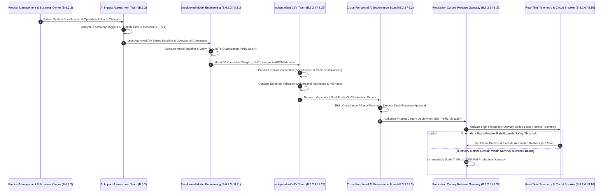

# Chapter 05: Annex B Part 1 Implementation Guidance (B.2 - B.6 Governance, AIA & Lifecycle)

## 1. Statutory Baseline & Technical Control Matrix

### 1.1 Evolution of AI Management Systems from Traditional Secure SDLC
While Annex A of ISO/IEC 42001:2023 specifies normative control objectives, Annex B provides concrete implementation guidance. Annex B details the operational mechanics required to plan, execute, and verify governance processes across complex organizational landscapes.

Within traditional cybersecurity architectures governed by ISO/IEC 27002:2022, systems development and governance rely heavily on controls 5.1 (Policies for information security), 5.2 (Division of responsibilities), 5.3 (Segregation of duties), 5.8 (Information security in project management), 8.25 (Secure development life cycle), and 8.31 (Separation of development, test and production environments). These controls provide effective defenses for deterministic, rule-based software environments where code execution paths are static and repeatable.

Machine learning architectures depart fundamentally from deterministic software paradigms. AI systems exhibit probabilistic inference, dynamic data dependency, opaque internal representations, and vulnerability to distribution shifts. Annex B Part 1 (Clauses B.2 through B.6) introduces specialized implementation principles tailored to these operational realities:
- **B.2 (AI Policies)**: Establishes guidance for formulating AI policies that define explicit boundaries, accountabilities, and procedures for managing policy exceptions.
- **B.3 (Internal Organization & Roles)**: Adapts the Three Lines of Defense model to machine learning operations, segregating model development from algorithmic risk oversight and independent verification. It introduces formal whistleblower mechanisms with anti-retaliation protections.
- **B.4 (AI Resources)**: Formulates governance across compute infrastructure, data pipelines, specialized tooling, and human capital. It mandates the evaluation of floating-point semantic disparities between development environments and production execution hardware.
- **B.5 (AI System Impact Assessment)**: Establishes a structured assessment framework initiated by three statutory triggers: context criticality, automation complexity, and data sensitivity. It standardizes analysis across vulnerable populations and broader societal dimensions.
- **B.6 (AI System Lifecycle Processes)**: Operationalizes end-to-end MLOps controls, including specification definition, sandboxed training, dual-track Verification and Validation (V&V), canary deployments equipped with automated circuit breakers, continuous drift telemetry, and immutable audit logging.

---

### 1.2 Statutory Crosswalk & Technical Control Matrix (Annex B.2 - B.6 vs. ISO/IEC 27002:2022)

| Annex B Guidance Section | Guidance Topic & Core Practice | ISO 27002:2022 Implementation Mapping | Integration Type | Technical Controls & Telemetry Metrics (KPI / KRI / KCI) |
| :--- | :--- | :--- | :--- | :--- |
| **B.2.2** | AI policy guidance | **5.1** Policies for information security | **Existing Extension** | Formulate responsible AI governance policies establishing risk tolerances, fairness standards, and formal exception processes. **KPI**: 100% organizational compliance with mandatory annual AI policy attestations. |
| **B.2.3** | Alignment with other policies | **5.1** Policies for information security **5.36** Compliance with policies | **Inter-Framework Integration** | Harmonize AI policies with ISO/IEC 38507 governance guidelines, enterprise privacy standards (ISO 27701), and IP protection protocols. **KCI**: 100% completion of cross-framework policy compatibility audits. |
| **B.2.4** | Review of the AI policy | **5.1** Policies for information security | **Existing Extension** | Conduct scheduled annual reviews and event-driven evaluations triggered by major architectural modifications, incidents, or legal shifts. **KPI**: 100% timely closure of scheduled annual policy review actions. |
| **B.3.2** | Roles and responsibilities guidance | **5.2** Division of responsibilities **5.3** Segregation of duties | **Existing Extension** | Establish the Three Lines of Defense for AI; separate duties between model engineering, feature store administration, V&V, and production sign-off. **KRI**: Zero instances of single-operator direct-to-production deployment privileges. |
| **B.3.3** | Reporting of concerns (Whistleblower protection) | **6.8** Information security event reporting *(Aligned with ISO 37002)* | **ISO 42001 Exclusive** | Deploy confidential and anonymous channels for reporting algorithmic defects, ethical risks, and safety bypasses, with strict anti-retaliation protections. **KPI**: 100% of reported AI concerns investigated within defined SLA windows. |
| **B.4.2** | Resource documentation | **5.9** Inventory of assets **5.37** Documented operating procedures | **Existing Extension** | Maintain comprehensive AI asset inventories featuring Data Flow Diagrams (DFDs) and architecture topologies to support impact assessments. **KPI**: 100% coverage of production AI services in central asset inventories. |
| **B.4.3** | Data resources | **8.12** Data leakage prevention **8.10** Information deletion | **AI-Specific Deepening** | Track data provenance, timestamps, annotation procedures (ISO/IEC 5259), and partition boundaries across training, validation, test, and live data. **KCI**: 100% verification rate for dataset licensing, lineage, and partition isolation. |
| **B.4.4** | Tooling resources | **8.25** Secure development life cycle **8.30** Outsourced development | **AI-Specific Deepening** | Govern MLOps platforms; evaluate floating-point semantic disparities between development clusters and deployment hardware to prevent numerical drift. **KRI**: Zero production inference divergence incidents caused by hardware floating-point mismatch. |
| **B.4.5** | Computing resources | **8.6** Capacity management **7.1** Physical security perimeters | **Existing Extension** | Manage compute constraints across cloud and edge hardware; track cluster energy consumption and carbon footprint profiles for sustainable operation. **KPI**: Compute infrastructure load factor maintained within target range (70% - 85%). |
| **B.4.6** | Human resources | **6.1** Screening **6.3** Information security awareness | **Existing Extension** | Assemble diverse development teams; train personnel in human oversight duties, adversarial risk mitigation, and algorithmic accountability. **KPI**: Minimum of 16 annual training hours in AI safety completed by key personnel. |
| **B.5.2** | AI impact assessment (AIA) process | **5.8** Information security in project management **8.25** Secure development life cycle | **ISO 42001 Exclusive** | Evaluate 3 statutory triggers (context criticality, automation complexity, data sensitivity); execute 5-step lifecycle: identify, analyze, evaluate, treat, document. **KPI**: 100% of high-risk AI deployments backed by completed, approved AIAs. |
| **B.5.3** | AIA documentation | **5.37** Documented operating procedures | **ISO 42001 Exclusive** | Archive AIA artifacts with defined retention periods; record positive/negative impact inventories, predictable failure modes, and human oversight logs. **KPI**: 100% archive completeness for mandatory AIA governance documentation. |
| **B.5.4** | Assessment of impact on individuals and groups | **5.36** Compliance with policies *(Aligned with ISO 27701)* | **ISO 42001 Exclusive** | Evaluate impacts across protected classes and 7 dimensions: fairness, transparency, privacy, safety, financial, accessibility, and human rights. **KCI**: Disparate Impact Ratio across protected demographic groups maintained between 0.8 and 1.2. |
| **B.5.5** | Societal impacts guidance | **5.30** ICT readiness for business continuity **5.5** Contact with authorities | **ISO 42001 Exclusive** | Evaluate macro impacts on labor displacement, environmental resources, democratic integrity, and systemic financial stability (ISO/IEC TR 24368). **KPI**: 100% of major enterprise deployments assessed for macro-societal risks. |
| **B.6.1** | Management guidance for responsible development | **8.25** Secure development life cycle | **AI-Specific Deepening** | Formalize organizational responsible development objectives (B.6.1.2) and trustworthy AI engineering procedures (B.6.1.3), incorporating formal change gates. **KCI**: 100% adherence to corporate responsible AI development baselines. |
| **B.6.2.2** | Requirements & specification | **8.26** Application security requirements | **AI-Specific Deepening** | Formulate specifications defining precision targets, generalization tolerances, explainability tiers, latency limits, and fail-safe fallback modes. **KPI**: 100% of project specifications containing quantified safety and reliability criteria. |
| **B.6.2.3** | Design & development documentation | **8.27** Secure architecture principles **8.28** Secure coding | **AI-Specific Deepening** | Document algorithmic structures, training pipelines, and feature stores; enforce container sandboxing; embed poisoning and model stealing defenses. **KRI**: Zero detected vulnerabilities in production model pipelines and serialization formats. |
| **B.6.2.4** | Verification and validation (V&V) | **8.29** Security testing in acceptance **8.31** Separation of environments | **ISO 42001 Exclusive** | Execute dual-track V&V: independent technical verification (code and mathematical compliance) and operational validation (fitness for business intent and safety). **KPI**: 100% of production releases approved through independent dual-track V&V gates. |
| **B.6.2.5** | Deployment guidance | **8.32** Change management | **Existing Extension** | Execute automated canary releases; implement real-time error-rate tripwires with automated rollback capabilities (< 3 minutes). **KPI**: 100% success rate for automated canary rollback tests during deployment simulations. |
| **B.6.2.6** | Operation and monitoring | **8.16** Monitoring activities **8.8** Management of technical vulnerabilities | **AI-Specific Deepening** | Monitor continuous learning drift, inference latency, and task accuracy; conduct scheduled adversarial injection tests; prohibit hot-patching. **KRI**: Zero undetected concept drift events exceeding established operational thresholds. |
| **B.6.2.7** | Technical documentation | **5.37** Documented operating procedures **8.27** Secure architecture principles | **AI-Specific Deepening** | Maintain observability runbooks, manual override instructions, model decommissioning procedures, and comprehensive AI Software Bills of Materials (AIBOM). **KPI**: 100% currency and availability of technical documentation for production assets. |
| **B.6.2.8** | Recording event logs | **8.15** Logging **8.12** Data leakage prevention | **Existing Extension** | Capture immutable audit logs recording inference inputs, decision scores, operator overrides, and regulatory compliance metadata in tamper-evident storage. **KPI**: 100% of production inference events captured in tamper-evident audit storage. |

---

## 2. Production Incident & Remediation Architecture

### 2.1 Incident Context: Automated Insurance Underwriting Engine Collapse via Lifecycle and Governance Failure
A multinational life insurance corporation initiated an aggressive digital transformation program, deploying a hybrid machine learning system combining a large language model (LLM) for medical record parsing with a gradient-boosted decision tree for automated underwriting risk assessment. To expedite product launch deadlines, project leadership dismantled standard engineering gates. A senior machine learning engineer was granted simultaneous administrative privileges across model development repositories and production cloud infrastructure.

Using an unmanaged workstation, the engineer bypassed formal change management controls (ISO/IEC 27002 Control 8.32) and uploaded retrained model weights directly to the live production cluster. This major update bypassed the required AI Impact Assessment update (Clause B.5.2) despite substantial modifications to underwriting risk scoring. Furthermore, the pipeline omitted independent dual-track Verification and Validation (V&V) (Clause B.6.2.4), and a mismatch in floating-point compilation libraries between the training GPU server (FP32) and production inference nodes (INT8 quantization) altered decision boundaries.

Within one week of release, organized fraud rings discovered systemic classification anomalies. By submitting crafted claim descriptions featuring specific semantic tokens, fraudulent claims totaling $1.2M were automatically approved and disbursed. Concurrently, legitimate claims submitted by terminally ill policyholders were erroneously rejected due to acute algorithmic overfitting. Regulatory authorities intervened, halting automated operations and penalizing the corporation for the total breakdown of its internal Three Lines of Defense.

### 2.2 Root Cause Analysis (RCA)
1. **Collapse of Segregation of Duties and Environment Boundaries (B.3.2, ISO 27002 5.2, 5.3, 8.31)**: A single practitioner possessed unchecked authority spanning code development, data engineering, model compilation, and production deployment. The lack of independent verification and release gating eliminated second-line governance over the production perimeter.
2. **Severed Link Between Impact Assessment and Change Gates (B.5.2, B.6.2.5, ISO 27002 5.8, 8.32)**: The enterprise failed to recognize structural changes to underwriting algorithms as statutory triggers requiring an updated AI Impact Assessment. Automated systems were modified without re-evaluating impacts on policyholder rights or financial exposure.
3. **Total Absence of Independent Dual-Track V&V (B.6.2.4, ISO 27002 8.29)**: The team conflated internal unit testing with formal acceptance. The model was deployed without independent mathematical verification or operational scenario validation under adversarial stress conditions.
4. **Tooling and Hardware Quantization Drift (B.4.4, ISO 27002 8.25)**: Development failed to account for floating-point semantic disparities between training hardware (FP32) and edge inference engines (INT8), creating numerical drift that distorted threshold sensitivity in live environments.
5. **Absence of Whistleblower Reporting Channels (B.3.3, ISO 27002 6.8)**: Junior data scientists had recognized anomalous validation test patterns prior to deployment, but lacked confidential, retaliation-free reporting mechanisms to escalate ethical and technical concerns past project management.

---

### 2.3 Remediation Architecture

---

## 3. Exam Question Bank & Distractor Forensics

### Question 1 (FIRST Action Scenario)
A global manufacturing conglomerate plans to replace its rule-based optical inspection systems with an automated deep learning computer vision model to identify structural defects in aerospace turbine components. The engineering team has drafted the technical architecture and performance requirements. In accordance with ISO/IEC 42001 Annex B.5.2 (AI impact assessment process) and B.6.2.2 (System requirements and specification), what governance action must the project director execute **FIRST** before approving model training and development?

- A. `(Recommended)` Convene a cross-functional assessment group to execute an AI Impact Assessment (B.5.2), analyzing potential physical safety risks, operator health implications, operational disruption severity, and statutory failure modes.
- B. Procure 64 high-density GPU computing nodes and immediately download open-source computer vision backbones directly to the shop floor servers.
- C. Permit production engineers to write real-time inference scripts directly on live factory cameras to test edge performance during active manufacturing runs.
- D. Issue a formal waiver declaring that industrial computer vision applications are exempt from impact assessments because factory inspection does not process consumer personal data.

#### Distractor Forensics
* **Option A is CORRECT**: Control B.5.2 and B.6.2.2 establish clear lifecycle gates. Before initiating development, the organization must perform an AI Impact Assessment triggered by the criticality of the context (aerospace manufacturing and physical safety). The AIA establishes the foundational risk profile, failure mode mitigations, and safety specifications that govern all subsequent architectural and validation activities.
* **Option B is INCORRECT**: Procuring hardware prior to defining architectural safety requirements and completing an AIA reverses proper lifecycle order. Resource provisioning (B.4.2, B.4.5) must derive from validated impact and capacity requirements.
* **Option C is INCORRECT**: Conducting real-time code modifications on live production machinery violates ISO/IEC 27002 Controls 8.31 (Separation of environments) and 8.25 (Secure development life cycle), creating unacceptable operational and physical safety risks.
* **Option D is INCORRECT**: ISO/IEC 42001 Clause B.5 explicit guidance mandates that AI Impact Assessments evaluate human safety, health, property, and environmental consequences. Restricting assessments solely to personal data protection misunderstands the standard.

---

### Question 2 (BEST/MOST Implementation Choice)
Under ISO/IEC 42001 Annex B.6.2.4 (Verification and validation guidance) and ISO/IEC 27002 Control 8.29 (Security testing in acceptance), an organization is preparing to deploy an automated medical triage classification model in emergency rooms. Which testing approach represents the **BEST** technical and governance implementation for production acceptance?

- A. `(Recommended)` Commission an independent testing team separate from development to execute dual-track acceptance: formally verifying that algorithms strictly adhere to mathematical specifications and code contracts, followed by empirical validation confirming clinical efficacy, fairness, and stability under edge-case stress conditions.
- B. Direct the original development engineers to calculate classification accuracy against the original training dataset, signing off on deployment if accuracy exceeds 90%.
- C. Conduct a brief five-minute administrative review of the user interface layout with clinical staff, approving production release based on graphic design usability.
- D. Base organizational deployment approval entirely on benchmark scores published on open-source leaderboard websites for the underlying foundation model.

#### Distractor Forensics
* **Option A is CORRECT**: Clause B.6.2.4 formally establishes dual-track evaluation: Verification confirms that system outputs conform to specifications and mathematical requirements, while Validation confirms that the system fulfills its intended operational mission safely under realistic conditions. Engaging an independent team ensures objective evaluation in alignment with ISO/IEC 27002 Control 8.29.
* **Option B is INCORRECT**: Evaluating models against their training data measures memorization rather than generalization, concealing severe overfitting and distribution shift vulnerabilities. Furthermore, self-testing by developers violates segregation of duties (B.3.2).
* **Option C is INCORRECT**: Visual interface reviews evaluate user ergonomics but fail to evaluate algorithmic reliability, error distributions, adversarial stability, or clinical safety.
* **Option D is INCORRECT**: Relying on external third-party leaderboards without conducting internal scenario-specific validation violates supply chain security principles and ignores local clinical operational realities.

---

### Question 3 (NEXT Action Scenario)
A commercial bank is deploying a machine learning anti-money laundering (AML) transaction monitoring engine into production using a canary release pattern (Clause B.6.2.5 and ISO/IEC 27002 Control 8.32), routing 5% of live transactions to the candidate model. Two hours post-activation, real-time telemetry (Clause B.6.2.6 and ISO/IEC 27002 Control 8.16) triggers an automated high-severity alarm: the canary instance false-positive alert rate has surged by 260%, flooding investigation queues and threatening statutory reporting SLAs. After verifying telemetry accuracy, what is the **NEXT** technical action the operations engineering team must take?

- A. `(Recommended)` Activate the deployment circuit breaker to immediately roll back canary traffic to the previous stable baseline version, notifying the AI governance board and model engineering teams to initiate root-cause investigation.
- B. Expand canary traffic allocation to 100% to evaluate whether higher transaction volume stabilizes alert distributions automatically.
- C. Silence monitoring alert feeds across operational communication channels and postpone discussion until the next monthly operations meeting.
- D. Purge all audit logs and transaction traces generated by the canary instance to free up database storage across the monitoring cluster.

#### Distractor Forensics
* **Option A is CORRECT**: Clause B.6.2.5 specifies that canary deployments must be paired with automated or rapid manual fallback mechanisms. When telemetry detects severe performance anomalies, operations teams must immediately trip circuit breakers and revert to stable baselines, containing business disruption before performing forensic root-cause analysis.
* **Option B is INCORRECT**: Increasing traffic allocation during an active incident expands the failure blast radius across the entire institution, exacerbating queue congestion and precipitating regulatory penalties.
* **Option C is INCORRECT**: Silencing alert channels violates ISO/IEC 27002 Control 8.16 (Monitoring activities) and deliberate concealment of performance anomalies prevents timely incident containment.
* **Option D is INCORRECT**: Purging production event traces destroys evidence required for forensic investigation, directly violating ISO/IEC 42001 Control B.6.2.8 (Recording event logs) and ISO/IEC 27002 Control 8.15 (Logging).

---

### Question 4 (PRIMARY Focus Scenario)
In establishing internal governance structures and operational oversight under ISO/IEC 42001 Annex B.3.2 (Roles and responsibilities) and B.3.3 (Reporting of concerns), which organizational principle serves as the **PRIMARY** control ensuring governance integrity across the AI lifecycle?

- A. `(Recommended)` Enforcing strict operational independence and distinct reporting channels among the Three Lines of Defense (development engineering, AI risk and ethics oversight, and internal audit), while maintaining confidential, retaliation-free whistleblower reporting channels.
- B. Appointing lead machine learning engineers to simultaneously serve as enterprise ethics officers and head of internal audit to minimize administrative headcount.
- C. Granting unrestricted root administrative privileges across production machine learning clusters to all staff members to maximize cross-team collaboration.
- D. Eliminating formal documentation and written approval records in favor of informal verbal understandings across the engineering team.

#### Distractor Forensics
* **Option A is CORRECT**: Clause B.3.2 requires clear segregation of duties across the Three Lines of Defense to eliminate conflicts of interest between delivery timelines and risk oversight. Clause B.3.3 complements this structure by establishing protected reporting mechanisms that allow employees to escalate risks without fear of retaliation, preserving organizational integrity.
* **Option B is INCORRECT**: Allowing development personnel to audit their own models creates severe conflicts of interest, completely invalidating the independence required by ISO/IEC 27002 Control 5.3 (Segregation of duties).
* **Option C is INCORRECT**: Granting unrestricted production access violates the principle of least privilege (ISO/IEC 27002 Control 8.2) and eliminates controls safeguarding the production perimeter.
* **Option D is INCORRECT**: Abandoning documented operating procedures violates ISO/IEC 42001 Clause 7.5 (Documented information) and ISO/IEC 27002 Control 5.37, preventing independent audits and regulatory verification.
