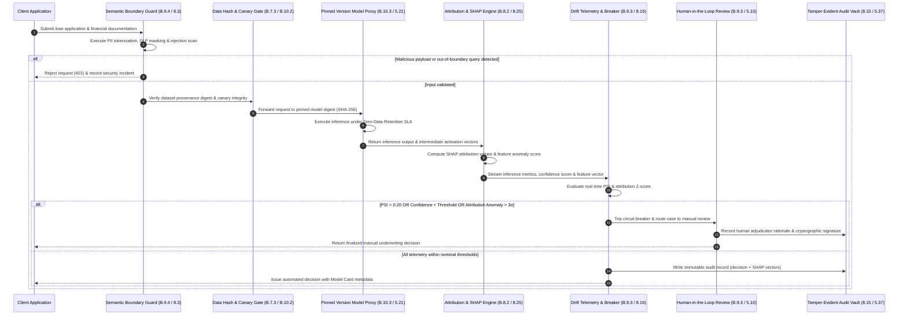

# Chapter 06: Annex B Part 2 Implementation Guidance (B.7 Data, B.8 Transparency, B.9 Use of AI & B.10 Third-Party Relationships)

## 1. Statutory Baseline & Technical Control Matrix

### 1.1 Overview & Architecture: Annex B Part 2 Guidance Framework & ISO 27002 Alignment
ISO/IEC 42001:2023 (CNS 42001:2026) Annex B provides non-mandatory but authoritative implementation guidance for Annex A controls. Annex A specifies what control objectives to achieve; Annex B defines how to implement engineering and governance workflows. Clauses B.7 through B.10 govern AI data engineering, stakeholder transparency, operational runtime controls, and supply chain relationships.

These clauses align directly with ISO/IEC 27002:2022 Clause 5 (Controls 5.19-5.23 for supplier security) and Clause 8 (Controls 8.10-8.28 for data masking, leakage prevention, cryptography, and secure development).

| Annex B Guidance Clause | Corresponding Annex A Control | Core Implementation Focus & Guidance Scope | ISO/IEC 27002:2022 Crosswalk |
| :--- | :--- | :--- | :--- |
| **B.7 Data for AI Systems** | A.7.2 - A.7.6 | Data lifecycle management, acquisition legality, quality validation, provenance tracking, and preparation workflows. | 5.9, 5.10, 5.20, 8.10, 8.11, 8.12, 8.24, 8.28 |
| **B.8 Information for Interested Parties** | A.8.2 - A.8.6 | System documentation, user information, comprehensibility, accessibility, external reporting, incident disclosure, and filings. | 5.4, 5.22, 5.24, 5.36, 5.37, 6.3, 6.8, 8.15, 8.25 |
| **B.9 Use of AI Systems** | A.9.2 - A.9.4 | Responsible use evaluation, trustworthy objectives, human oversight, operational boundary enforcement, and event logging. | 5.10, 5.36, 6.3, 8.2, 8.3, 8.4, 8.15, 8.16, 8.17 |
| **B.10 Third-Party Relationships** | A.10.2 - A.10.4 | Lifecycle responsibility allocation, controller/processor boundaries, foundation model MaaS supplier governance, and domain limits. | 5.11, 5.19, 5.20, 5.21, 5.22, 5.23 |

---

### 1.2 Comprehensive Control Mapping Matrix: Annex B.7 - B.10 vs. ISO 27002:2022

| ISO 42001 Guidance Clause | Core Implementation Guidance Scope | ISO 27002:2022 Mapping | Integration Type | Technical Controls & Telemetry Metrics (KPI / KRI / KCI) |
| :--- | :--- | :--- | :--- | :--- |
| **B.7.2 Data for AI Systems Development** (Aligned with A.7.2) | Document data management across AI development; assess privacy impacts of training data; safeguard integrity and feature representativeness (ISO/IEC 22989). | **5.10** Acceptable use of assets **8.12** Data leakage prevention **8.28** Secure coding | **AI-Specific Deepening** | Enforce data management SOPs; maintain feature store inventory controls and demographic profiling. **KPI**: Training data governance SOP compliance = 100%. **KRI**: Unauthorized access incidents of sensitive training features = 0. |
| **B.7.3 Data Acquisition** (Aligned with A.7.3) | Document data sourcing (commercial, open-source, synthetic, streaming); verify subject consent, processing legality, and contractual rights (ISO/IEC 19944-1). | **5.20** Supplier agreements **8.10** Information deletion | **AI-Specific Deepening** | Enforce data acquisition checklists; maintain licensing ledgers and automated right-to-be-forgotten deletion pipelines. **KCI**: Dataset legal licensing completeness = 100%. **KRI**: Unlicensed or contaminated dataset ingestion events = 0. |
| **B.7.4 Data Quality** (Aligned with A.7.4) | Define quality metrics (completeness, accuracy per ISO/IEC 25024); sanitize train/val/test splits; evaluate bias impacts on performance (ISO/IEC 5259, TR 24027). | **8.12** Data leakage prevention **8.16** Monitoring activities **8.28** Secure coding | **AI-Specific Deepening** | Execute automated schema validation (Great Expectations); detect distribution anomalies and class imbalance. **KPI**: Automated data quality pipeline coverage >= 98%. **KRI**: Feature missingness threshold violation rate < 0.5%. |
| **B.7.5 Data Provenance** (Aligned with A.7.5) | Implement data lineage tracking (ISO 8000-2 covering creation, transformation, labeling, validation, and custody transfers throughout the lifecycle). | **5.9** Inventory of assets **8.15** Logging **8.24** Cryptography | **Existing Expansion** | Bind datasets to Git commits and SHA-256 hashes via DVC/MLflow; generate machine-readable AI Bills of Materials (AIBOM). **KPI**: Model artifact to dataset lineage linkage = 100%. **KCI**: Dataset provenance audit trail completeness = 100%. |
| **B.7.6 Data Preparation** (Aligned with A.7.6) | Document data preparation methodology; handle missing values, scaling, and class imbalances; execute cleaning, normalization, and feature encoding (ISO/IEC 23053). | **8.11** Data masking **8.12** Data leakage prevention **8.28** Secure coding | **Cross-System Integration** | Enforce automated PII tokenization, dynamic data masking, and differential privacy (DP-SGD) to prevent re-identification attacks. **KPI**: Sensitive PII field masking prior to training = 100%. **KRI**: Reconstruction attack success rate < 0.01%. |
| **B.8.2 System Documentation & User Information** (Aligned with A.8.2) | Provide user notices: system purpose, AI interaction disclosure, synthetic output labeling, operational boundaries, override steps, and limitations. | **5.37** Operating procedures **5.22** Monitoring services **8.25** Secure SDLC | **42001 Unique** | Publish standardized public Model Cards and System Cards disclosing intended use, verified metrics, watermarking, and fail-safe conditions. **KPI**: External Model Card publication timeliness = 100%. **KCI**: Stakeholder transparency grievances or inquiries = 0. |
| **B.8.3 Information Comprehensibility & Accessibility** (Aligned with A.8.3) | Ensure disclosures are clear and context-appropriate; differentiate technical administrative manuals from general consumer notices; verify WCAG compliance. | **5.37** Operating procedures **6.3** Security awareness | **42001 Unique** | Author tiered guides (technical manuals vs. plain-language notices); conduct usability readability tests and accessibility audits. **KPI**: Consumer documentation comprehension score >= 90%. **KCI**: Non-compliance findings in accessibility audits = 0. |
| **B.8.4 External Reporting** (Aligned with A.8.4) | Establish channels for external reporting of algorithmic harms, discrimination, misclassifications, and ethical vulnerabilities beyond internal monitoring. | **5.4** Management responsibilities **5.7** Threat intelligence **6.8** Event reporting | **Existing Expansion** | Implement a public AI vulnerability and algorithmic bias reporting portal; enforce defined triage response SLAs based on severity. **KPI**: External harm report response within SLA = 100%. **KRI**: Unresolved external discrimination reports = 0. |
| **B.8.5 Incident Communication** (Aligned with A.8.5) | Maintain documented communication playbooks for AI-specific failures, data breaches, and safety malfunctions; define notification thresholds and deadlines. | **6.8** Event reporting **5.24** Incident planning | **Existing Expansion** | Define AI incident taxonomy (model evasion, poisoning, hallucinations); formalize PR and regulatory reporting escalation protocols. **KPI**: High-severity AI safety incident notification within 1 hour = 100%. **KRI**: Mean time to contain unexpected output incidents < 4 hours. |
| **B.8.6 Information to Interested Parties** (Aligned with A.8.6) | Fulfill obligations to disclose architectures, verification and validation (V&V) records, impact assessments (AIA), and audit logs to authorities and clients. | **5.4** Management responsibilities **5.36** Compliance with policies **8.15** Logging | **Existing Expansion** | Automate generation of compliance packages containing algorithmic filings, evaluation telemetry, and third-party audit attestations. **KPI**: Statutory algorithmic filing overdue count = 0. **KCI**: Regulatory disclosure discrepancy findings = 0. |
| **B.9.2 Processes for Responsible Use** (Aligned with A.9.2) | Establish governance for acquiring, deploying, and operating AI systems; define sign-off thresholds, TCO, procurement criteria, and acceptable use policies. | **5.10** Acceptable use of assets **5.36** Compliance with policies **8.2** Privileged access | **Existing Expansion** | Deploy enterprise AI access gateways; enforce prompt filtering, data egress inspection, and commercial tool approval workflows. **KPI**: Employee Responsible AI Acceptable Use sign-off = 100%. **KRI**: Unauthorized generative AI tool usage events = 0. |
| **B.9.3 Objectives for Responsible Use & Human Oversight** (Aligned with A.9.3) | Establish trustworthy AI objectives (fairness, transparency, operational stability, privacy); enforce meaningful human oversight (HITL) via validation gates. | **5.10** Acceptable use of assets **6.3** Security awareness **8.16** Monitoring activities | **AI-Specific Deepening** | Embed mandatory human-in-the-loop review nodes for high-stakes inferences; record tamper-evident human override justifications and review logs. **KPI**: High-risk algorithmic decision human review rate = 100%. **KRI**: Override capability failure or runaway autonomous events = 0. |
| **B.9.4 Intended Use & Operational Boundaries** (Aligned with A.9.4) | Operate systems within documented parameters (B.8.2); allocate oversight resources; validate inputs; monitor drift (B.6.2.6); maintain audit logs. | **8.3** Access restriction **8.4** Source code access **8.16** Monitoring activities **8.17** Clock synchronization | **AI-Specific Deepening** | Implement semantic firewalls to block out-of-domain queries; compute real-time feature drift (Population Stability Index - PSI) and confidence scores. **KPI**: Semantic boundary defense interception accuracy >= 99.5%. **KRI**: Response time to critical drift alert (PSI > 0.25) < 30 minutes. |
| **B.10.2 Allocation of Responsibilities** (Aligned with A.10.2) | Delineate lifecycle responsibilities across data providers, model developers, integrators, and deployers; execute DPAs; define PII controller/processor roles. | **5.11** Return of assets **5.20** Supplier agreements | **Cross-System Integration** | Construct an AI supply chain RACI matrix; execute comprehensive DPAs detailing liability boundaries, indemnification, and IP allocation. **KPI**: Signed AI supplier responsibility agreement rate = 100%. **KCI**: Regulatory disputes from ambiguous controller/processor roles = 0. |
| **B.10.3 Supplier Management** (Aligned with A.10.3) | Ensure suppliers enforce responsible AI controls; mandate AIMS conformity; evaluate foundation model providers, annotation vendors, and cloud hosts. | **5.19** Supplier security **5.20** Supplier agreements **5.21** ICT supply chain **5.22** Monitoring services **5.23** Cloud services | **AI-Specific Deepening** | Institute technical supplier evaluation checklists; execute canary poisoning tests against annotators; audit cloud MaaS isolation and cryptographic controls. **KPI**: Critical AI supplier annual compliance audit coverage = 100%. **KRI**: Unnotified upstream model changes or poisoned annotation batches = 0. |
| **B.10.4 Customer Relationships** (Aligned with A.10.4) | Analyze customer expectations; communicate deployment risks, technical boundaries, and domain limits (B.6.2.7, B.8.2); establish dispute appeal mechanisms. | **5.11** Return of assets **5.20** Supplier agreements **5.22** Monitoring services | **42001 Unique** | Publish terms of service specifying AI-assisted operational limits and customer indemnification boundaries; deploy customer decision appeal portals. **KPI**: Customer algorithmic decision dispute compliance = 100%. **KCI**: Mandatory statutory customer disclosure completeness = 100%. |

---

### 1.3 Technical Deep-Dive: Foundation Model MaaS SLA, Data Annotation Outsourcing & Explainability Auditing

#### 1.3.1 Foundation Model as a Service (MaaS) SLA & Integration Architecture
When integrating commercial foundation model APIs (e.g., LLMs, vision backbones), organizations enforce strict contractual and architectural controls:
1. **Zero-Data-Retention (ZDR) Enforcement**: Contractually prohibit the provider from storing, logging, or employing enterprise prompt payloads or completions for model retraining. Verify via enterprise privacy agreements and API metadata telemetry.
2. **Immutable Version Pinning & Digest Locking**: Disallow floating API endpoints (e.g., model-latest). Require explicit, immutable model snapshots pinned by cryptographic model digest (e.g., model-id@sha256:...). Mandate a 60-day deprecation advance notification SLA prior to version retirements.
3. **Network Isolation & Confidential Computing**: Enforce private networking (AWS PrivateLink, Azure Private Endpoint) and mutual TLS (mTLS) with multi-tenant memory encryption (AMD SEV-SNP, Intel TDX) to eliminate exposure over public routes.

#### 1.3.2 Data Annotation Outsourcing Safeguards & Anti-Poisoning Architecture
Outsourcing data labeling introduces supply chain risks, including label flipping, backdoor injection, and data exfiltration. Technical countermeasures include:
1. **Isolated Virtual Desktop Infrastructure (VDI)**: Annotators access data exclusively through zero-trust, ephemeral VDI sessions with disabled clipboard, screenshot prevention, watermarking, and zero local download privileges.
2. **Cryptographic Lineage with Sigstore & DVC**: Every delivered dataset batch must be cryptographically signed by the vendor key via Sigstore/Cosign and indexed via Data Version Control (DVC) paired with immutable Git commit hashes.
3. **Canary Trap Injection (Honey-Tokens)**: Security pipelines inject a secret 5% proportion of pre-verified canary samples with known ground-truth labels into each outsourced batch. If an annotation batch shows accuracy below 99% on the canary subset, the pipeline automatically rejects the batch and freezes vendor credentials.

#### 1.3.3 Explainability & Interpretability Audit Telemetry (SHAP / Grad-CAM)
ISO 42001 B.8.2 and B.9.3 require verifiable transparency in automated decisioning:
1. **Tabular & NLP Decision Attribution (SHAP)**: For high-stakes models, compute Shapley Additive exPlanations (KernelSHAP or TreeSHAP) for every inference. Store top contributing feature attribution vectors alongside model outputs in an append-only, tamper-evident audit store.
2. **Computer Vision Spatial Localization (Grad-CAM)**: For vision models, compute Gradient-weighted Class Activation Mapping heatmaps. Archive activation heatmaps alongside input images to provide verifiable forensic evidence demonstrating that predictions rely on legitimate clinical or physical features rather than background artifacts.
3. **Outlier Attribution Anomaly Detection**: Monitor real-time SHAP values; if an individual decision feature attribution diverges by more than 3 standard deviations from baseline historical attributions, route the transaction to mandatory human-in-the-loop review.

---

## 2. Production Incident & Remediation Architecture

### 2.1 Incident Context: Financial Document Recognition & Credit Underwriting System Backdoor & Drift
A multinational financial technology company deployed an automated business loan adjudication and financial document analysis platform. The production architecture employed an external commercial Foundation Model API for unstructured financial statement extraction, combined with a proprietary gradient-boosted decision tree and deep neural network fine-tuned on historical credit data by a third-party annotation outsourcing vendor. The entire inference pipeline ran on a multi-tenant cloud container platform.

Three months post-deployment, an internal compliance audit uncovered critical systemic failures:
1. The automated system erroneously approved over $4.2 million in high-risk unsecured commercial loans to shell corporate applicants containing specific alphanumeric strings in their financial reports.
2. The upstream Foundation Model provider silently updated its underlying model weights during an unannounced maintenance window, causing downstream tabular feature extraction F1-scores to drop from 0.94 to 0.61.
3. An investigation revealed that an outsourced annotation contractor account had been compromised by an adversary. Over 8,000 fine-tuning samples had been manipulated with backdoor trigger tokens associated with approved credit ratings. Because the enterprise lacked input feature explainability telemetry and cryptographic dataset provenance validation, the backdoor operated undetected for 90 days.

### 2.2 Root Cause Analysis (RCA)
1. **Inadequate Annotation Supply Chain Integrity & Anti-Poisoning Controls (B.7.3 / B.10.2 / ISO 27002 5.20, 8.12)**:
   The MLOps data ingestion pipeline ingested delivered annotation files directly into fine-tuning without cryptographic digest verification (DVC/Sigstore), independent label validation, or canary honey-token injection.
2. **Uncontrolled Foundation Model Dependencies & Missing Version SLAs (B.10.3 / ISO 27002 5.21, 5.22)**:
   API calls executed against a floating endpoint tag (financial-llm-current) rather than a pinned immutable model digest. The vendor agreement lacked an advance change notification clause, and the deployment team implemented no automated regression gateway.
3. **Absence of Explainability Telemetry & Runtime Drift Circuit Breakers (B.8.2 / B.9.3 / ISO 27002 8.16)**:
   The inference cluster lacked real-time feature attribution (SHAP/Grad-CAM) logging, blinding operators to anomalous decision factors. Furthermore, the system lacked automated drift detection (Population Stability Index - PSI) and fallback degradation mechanisms.

---

### 2.3 Remediation Architecture & Defense-in-Depth Implementation

#### Technical Defense Implementation Configuration Details
1. **Outsourced Annotation Pipeline Hardening**:
   - Mandate DVC tracking with Sigstore cryptographic signing for all outsourced deliverables.
   - Enforce an automated pre-merge evaluation pipeline injecting a secret 5% canary honey-token partition. If canary label consistency falls below 99.0%, the pipeline automatically aborts the ingest job, alerts security, and quarantines the deliverable.
2. **Foundation Model API Interface Governance**:
   - Enforce explicit model digest pinning (model version pinned to exact immutable digest) over private endpoints.
   - Execute bilateral SLAs requiring Zero-Data-Retention and a mandatory 60-day deprecation notice period supported by automated daily regression tests against a golden benchmark dataset.
3. **Inference Telemetry, Explainability & Automated Circuit Breakers**:
   - Deploy Evidently AI telemetry calculating the Population Stability Index (PSI) every 15 minutes across streaming input batches.
   - Compute real-time TreeSHAP values for all credit risk predictions. When PSI exceeds 0.20, model confidence drops below 85%, or any single feature attribution deviates by more than 3 standard deviations, the circuit breaker automatically reroutes the transaction to the Human-in-the-Loop (HITL) underwriting queue.

---

## 3. Exam Question Bank & Distractor Forensics

### Question 1 (FIRST Action Scenario)
An e-commerce enterprise certified under ISO/IEC 27001:2022 is implementing ISO/IEC 42001:2023. The organization plans to integrate a third-party commercial Foundation Model API (Model-as-a-Service, MaaS) to power its customer support and return resolution system. In accordance with ISO 42001 implementation guidance B.10.3 (Supplier management) and ISO/IEC 27002:2022 Control 5.19 (Supplier relationships), what should the project team perform FIRST before finalizing the integration agreement?

- A. `(Recommended)` Evaluate vendor data privacy commitments and architectural guarantees to confirm Zero-Data-Retention (ZDR) compliance and immutable model version pinning, preventing unauthorized model retraining on corporate prompts and unannounced weight shifts.
- B. Download the full deep neural network raw parameter weights onto an on-premises development server to perform automated Static Application Security Testing (SAST).
- C. Revise the enterprise-level Information Security Policy to enforce an absolute ban on all outbound cloud API connections across the organization.
- D. Purchase high-performance GPU cluster infrastructure to prepare for full on-premises hosting of the foundation model.

#### Distractor Forensics
* **Option A is CORRECT**: Per ISO 42001 B.10.3 and ISO 27002 5.19/5.20, the foundational first step when procuring external AI services is assessing supplier contractual terms, data usage policies, and architectural boundaries. Verifying Zero-Data-Retention and immutable version pinning establishes the necessary legal and technical baseline.
* **Option B is INCORRECT**: Proprietary commercial foundation models are delivered as managed black-box APIs; vendors do not distribute raw weights. SAST tools inspect source code, not neural weights.
* **Option C is INCORRECT**: An outright ban on external APIs paralyzes legitimate business operations and contradicts balanced risk treatment under ISO 42001 Clause 6.1.
* **Option D is INCORRECT**: Procuring capital-intensive GPU hardware prior to completing architectural feasibility analysis represents a severe misallocation of organizational resources.

---

### Question 2 (BEST/MOST Implementation Choice)
A medical diagnostic software developer plans to outsource the annotation of 500,000 multi-modal physiological sensor records to an external data labeling provider to train an assisted clinical triage model. Under ISO/IEC 42001 guidance B.7.4 (Data quality), B.7.6 (Data preparation), B.10.2 (Allocation of responsibilities), and ISO/IEC 27002 Controls 8.11 (Data masking) and 5.20 (Supplier agreements), which represents the BEST technical and organizational control implementation?

- A. `(Recommended)` Execute a binding Data Processing Agreement (DPA) with strict NDAs; perform irreversible de-identification and cryptographic pseudonymization prior to transmission; restrict annotation to an isolated, zero-egress Virtual Desktop Infrastructure (VDI) with disabled downloads and screen captures; and inject random canary verification samples to continuously audit labeling integrity and detect data poisoning.
- B. Transmit raw, unmasked clinical sensor records as plaintext CSV files via encrypted email to the vendor, requiring annotators to sign personal pledges promising to delete local copies upon task completion.
- C. Rely exclusively on an executive compliance attestation from the vendor while providing raw patient records without masking to preserve clinical feature fidelity.
- D. Reassign internal software quality assurance engineers to manually label all 500,000 records on part-time hours to avoid external supplier exposure.

#### Distractor Forensics
* **Option A is CORRECT**: This architecture aligns with B.7.6 (data masking), B.10.2 (contractual responsibility), and B.10.3 (supplier monitoring). Combining legal safeguards (DPA/NDA), technological access boundaries (isolated VDI), and automated quality/anti-poisoning controls (canary honey-tokens) delivers defense-in-depth.
* **Option B is INCORRECT**: Violates ISO 27002 Controls 5.20, 8.10, and 8.12. Distributing unmasked data to external local endpoints without egress controls creates massive data breach liability.
* **Option C is INCORRECT**: Violates ISO 27701 and ISO 27002 8.11 privacy-by-design requirements. Relying solely on written vendor attestations without technical masking exposes the organization to regulatory sanctions.
* **Option D is INCORRECT**: Assigning 500,000 complex clinical records to non-specialized internal QA engineers causes operational gridlock and severe labeling error rates.

---

### Question 3 (NEXT Action Scenario)
A financial institution operates an automated credit scoring AI model integrated with continuous operational telemetry in accordance with ISO 42001 B.9.3. The production monitoring dashboard triggers a critical alert: the Population Stability Index (PSI) on incoming loan applicant features has reached 0.33 over four consecutive business days (surpassing the critical drift threshold of 0.25), and model default prediction accuracy has dropped among borderline credit applicants. Under ISO 42001 B.9.3, B.9.4, and ISO 27002 Controls 8.16 (Monitoring activities) and 6.8 (Event reporting), what should the operations and risk team do NEXT?

- A. `(Recommended)` Immediately trip the automated circuit breaker to divert borderline credit adjudication to the predetermined manual underwriting queue or rule-based fallback system; freeze autonomous model loan approvals; and open an AI security and drift incident ticket for root-cause investigation.
- B. Disable PSI alert notifications on the operations dashboard to prevent alarm fatigue and postpone remediation until the next quarterly audit.
- C. Trigger continuous online learning immediately within the production cluster to retrain model weights in real time on incoming production data without offline validation.
- D. File an immediate breach of contract lawsuit in court against the third-party algorithm vendor demanding financial damages.

#### Distractor Forensics
* **Option A is CORRECT**: When critical telemetry indicates severe distribution drift (PSI > 0.25) and accuracy drops, the immediate priority under B.9.3 is operational risk containment. Tripping the circuit breaker to activate manual fallback prevents improper disbursements while formal root-cause analysis proceeds.
* **Option B is INCORRECT**: Suppressing active security and performance alerts violates ISO 27002 Control 8.16 and ISO 42001 Clause 9 performance monitoring mandates.
* **Option C is INCORRECT**: Retraining models directly in live production environments without offline verification and validation (V&V per B.6.2.4) introduces catastrophic forgetting and vulnerability to feedback loops.
* **Option D is INCORRECT**: Initiating legal litigation prior to internal technical root-cause investigation is premature and procedurally flawed.

---

### Question 4 (PRIMARY/EXCEPT Scenario)
When an enterprise evaluates a third-party cloud Model-as-a-Service (MaaS) inference hosting provider and drafts a Service Level Agreement (SLA) pursuant to ISO/IEC 42001 B.10.3 and ISO/IEC 27002:2022 Controls 5.22 and 5.23, which of the following requirements is EXCEPT an invalid, technically unfeasible, or ungrounded contractual demand?

- A. Mandating a legally binding contractual warranty from the cloud hosting vendor guaranteeing that the hosted generative model achieves 100.0% zero-error rate and zero hallucinations across all operational customer inputs.
- B. Mandating independent third-party audit reports (such as SOC 2 Type II or ISO/IEC 27001 certifications) attesting to the physical and logical security of the multi-tenant hosting facilities.
- C. Requiring hardware-enforced memory isolation, tenant network virtualization, and encrypted private peering for all inference API transactions.
- D. Specifying explicit service availability targets (uptime %), maximum inference latency percentiles (P95/P99), advance notification windows for version deprecation, and Recovery Time / Point Objectives (RTO/RPO).

#### Distractor Forensics
* **Option A is CORRECT (Valid Choice as the EXCEPT item)**: Machine learning models and deep neural networks are fundamentally probabilistic statistical systems. Demanding a legally binding guarantee of 100% zero errors and complete elimination of hallucinations from an infrastructure hosting provider is technically impossible and ungrounded.
* **Option B is INCORRECT (Legitimate Requirement)**: Independent third-party audit attestations are standard statutory mechanisms required under ISO 27002 Control 5.21 and 5.22 to verify supplier baseline security posture.
* **Option C is INCORRECT (Legitimate Requirement)**: Hardware-enforced memory isolation and private network peering satisfy ISO 27002 Control 5.23 (Cloud services security) in multi-tenant environments.
* **Option D is INCORRECT (Legitimate Requirement)**: Explicit latency percentiles, uptime SLAs, deprecation notification windows, and disaster recovery metrics are standard operational requirements ensuring business continuity under ISO 27002 Control 8.14.
